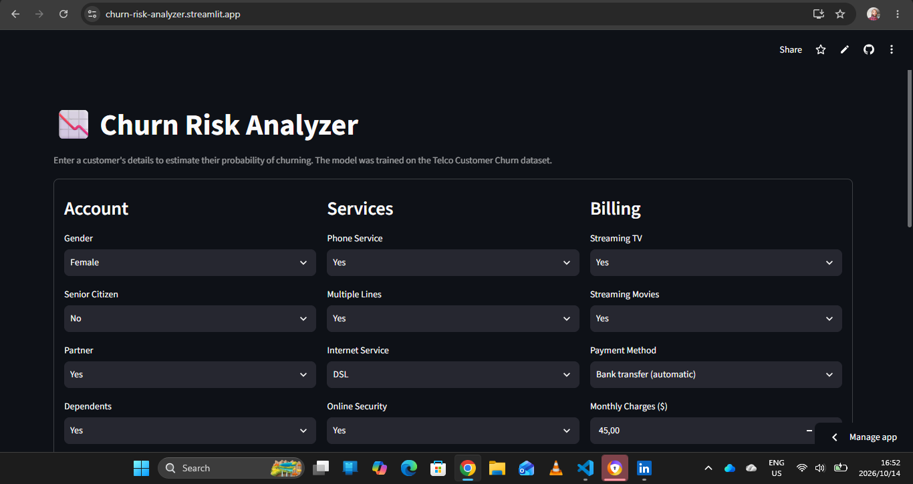
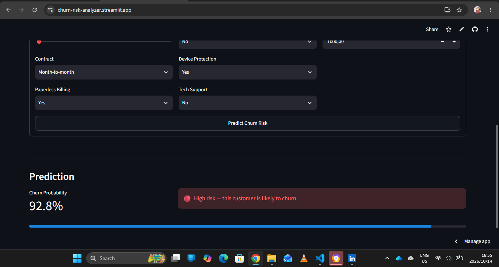
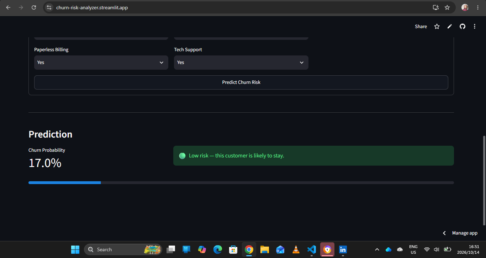

# 📉 Churn Risk Analyzer


Predict customer churn probability from account, service, and billing data. Trained on the [Telco Customer Churn](https://raw.githubusercontent.com/IBM/telco-customer-churn-on-icp4d/master/data/Telco-Customer-Churn.csv) dataset.

**🔗 Live demo:** [https://churn-risk-analyzer.streamlit.app](https://churn-risk-analyzer.streamlit.app)

---

## Screenshots

| Input form | High risk | Low risk |
|---|---|---|
|  |  |  |

---

## Features

- End-to-end ML pipeline — data ingestion, cleaning, training, evaluation, and inference.
- Scikit-learn `Pipeline` wrapping preprocessing and classifier to prevent data leakage.
- FastAPI backend with automatic request validation and interactive documentation.
- Streamlit UI for interactive predictions.
- Automated tests with pytest for the model and API.
- GitHub Actions CI — retrains the model from scratch on every push.
- Docker support for reproducible deployment.

---

## Model Performance

| Metric | Score |
|---|---:|
| ROC-AUC (5-fold CV) | 0.846 |
| ROC-AUC (held-out test) | 0.834 |
| Recall (churned) | 0.797 |
| Precision (churned) | 0.489 |
| F1 (churned) | 0.606 |

**Why recall over precision?**

In a customer retention context, missing a customer who is likely to churn can cost more than making an unnecessary retention offer. The model is deliberately tuned to identify more potential churners, accepting a higher false-positive rate.

**Model choice:**

Logistic Regression outperformed Random Forest on cross-validated ROC-AUC. The signal in this dataset is largely linear, so a simpler and more interpretable model was preferred.

---

## Architecture

```text
┌─────────────────────────────┐
│   Telco Churn (raw CSV)     │
└──────────────┬──────────────┘
               ▼
┌─────────────────────────────┐
│       src/data.py           │
│    Data cleaning            │
└──────────────┬──────────────┘
               ▼
┌─────────────────────────────┐
│       src/train.py          │
│    ColumnTransformer        │
│    LogisticRegression       │
│    → models/churn_model.joblib
└──────────────┬──────────────┘
               ▼
┌─────────────────────────────┐
│      src/predict.py         │
│   predict_one / predict_batch
└──────────────┬──────────────┘
               ▼
       ┌───────┴────────┐
       ▼                ▼
┌───────────────┐ ┌──────────────────┐
│  app/api.py   │ │ app/streamlit_app│
│ FastAPI       │ │ Interactive UI   │
│ /predict      │ │                  │
└───────────────┘ └──────────────────┘
```

---

## Tech Stack

| Layer | Tools |
|---|---|
| Data & ML | pandas, scikit-learn, joblib |
| Backend API | FastAPI, uvicorn, Pydantic |
| Frontend | Streamlit |
| Testing | pytest, httpx |
| CI/CD | GitHub Actions |
| Deployment | Streamlit Community Cloud, Docker |

---

## Quickstart

### 1. Clone and set up

```bash
git clone https://github.com/Andile1-tech/churn-predictor.git
cd churn-predictor

python -m venv venv
```

Activate the virtual environment.

**macOS / Linux:**

```bash
source venv/bin/activate
```

**Windows PowerShell:**

```powershell
.\venv\Scripts\Activate.ps1
```

Install dependencies:

```bash
python -m pip install -r requirements.txt
```

### 2. Build the data and train the model

```bash
python -m src.data
python -m src.train
```

The first command downloads and cleans the dataset. The second trains and evaluates the model and saves the trained pipeline to `models/churn_model.joblib`.

### 3. Run the app

**Streamlit UI:**

```bash
streamlit run app/streamlit_app.py
```

**FastAPI backend (optional):**

```bash
uvicorn app.api:app --reload --port 8000
```

Interactive API documentation: [http://localhost:8000/docs](http://localhost:8000/docs)

### 4. Run tests

```bash
pytest -v
```

---

## Project Structure

```text
churn-predictor/
├── .github/
│   └── workflows/
│       └── ci.yml                 # CI: install, retrain, test
├── app/
│   ├── api.py                     # FastAPI service
│   └── streamlit_app.py           # Streamlit UI
├── data/                          # Gitignored; regenerated by src/data.py
├── docs/                          # README screenshots
├── models/
│   ├── churn_model.joblib         # Trained pipeline
│   └── metrics.json               # Saved evaluation metrics
├── notebooks/
│   └── 01_eda.ipynb               # Exploratory data analysis
├── src/
│   ├── config.py                  # Paths and constants
│   ├── data.py                    # Download, clean, save
│   ├── train.py                   # Pipeline, CV, grid search
│   └── predict.py                 # Inference helpers
├── tests/
│   ├── test_api.py                # FastAPI endpoint tests
│   └── test_predict.py            # Model behavior tests
├── Dockerfile
├── requirements.txt
└── README.md
```

---

## Docker

Build the Docker image:

```bash
docker build -t churn-api .
```

Run the container:

```bash
docker run -p 8000:8000 churn-api
```

The FastAPI backend will be available at [http://localhost:8000/docs](http://localhost:8000/docs).

---

## Dataset

[Telco Customer Churn dataset](https://raw.githubusercontent.com/IBM/telco-customer-churn-on-icp4d/master/data/Telco-Customer-Churn.csv)

- Original dataset: 7,043 customers and 21 columns.
- Contains customer demographics, subscribed services, contract details, and billing information.
- After cleaning: 7,032 rows and 19 features.

---

## License

This project is licensed under the MIT License. See the [LICENSE](LICENSE) file for details.
